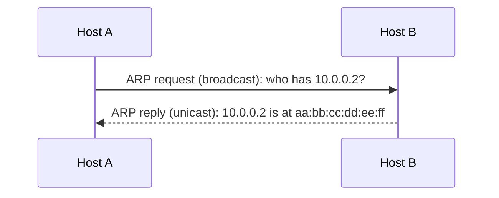
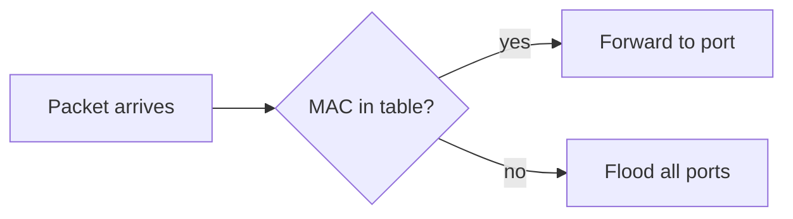

This guide is a draft, so it never goes live. Read it in Obsidian, or in the preview
at `localhost:1313/notes/writing-guide/` (VS Code: **Tasks: Run Task → Blog: preview**).

Every example has two parts. **You type** is exactly what goes in the note.
**You get** is the result, drawn by the site itself, so it's what readers will see.

## Part 1: Doing things

### Start a note

| If I do this | I get this |
|---|---|
| In Obsidian, right-click **notes** → **New note**, name it `Subnetting Cheatsheet` | A file `content/notes/Subnetting Cheatsheet.md`. Its web address will be `/notes/subnetting-cheatsheet/` |
| Do the same in a course folder, e.g. **training → computer-networks** | The note is listed on the Computer Networks course page automatically |
| Press **Alt+T** and pick **Note** (or **Course note**) | The properties block at the top fills in. See below |

After **Alt+T → Note**, the top of the file looks like this. Obsidian shows it as a
properties panel; this is the text underneath:

```yaml
---
title: "Subnetting Cheatsheet"
date: 2026-10-31T10:15:00+05:30
draft: true
tags: []
---
```

| Property | If I set it | I get |
|---|---|---|
| `title` | `"Subnetting Cheatsheet"` | The heading on the page and in the notes list. The file name doesn't change |
| `tags` | `[networking, ipv4]` | The note is listed on `/tags/networking/` and `/tags/ipv4/` |
| `summary` | `"Every /n to hosts conversion I keep looking up."` | That sentence appears under the title in the notes list. Without it, the list shows the first lines of the note |
| `draft` | `true` (ticked) | Visible only in your preview, never on the live site |
| `draft` | `false` (unticked) | Goes live on the next push |
| `date` | A date later than now | Hidden. It appears with the first push after that time, not on its own. Keep the `+05:30` on the end, or the time is read as UTC |

### Publish, change, delete

| If I do this | I get this |
|---|---|
| Untick **draft**, but don't push | Nothing changes on the live site yet. The preview shows it without the draft icon |
| Untick **draft**, then commit and push | The note goes live at `sushantbhargav.com/notes/<name>/`, usually within a couple of minutes |
| Edit a published note, then push | The page updates. If the edit is more than a day after the note's date, **Updated &lt;date&gt;** shows under the title |
| Delete the note's file, then push | The page disappears from the site |
| Rename the file | The web address changes, and the old address stops working |

**Commit and push from VS Code:** open Source Control (Ctrl+Shift+G), type a short
message such as `Add subnetting note`, click **Commit**, then **Sync Changes**.

### When something is wrong

| If I do this | I get this |
|---|---|
| Link to a note that doesn't exist | The page still builds, the link is broken, and the build prints `WARN Link to "x.md": no such page` with the file and line |
| Use an image that isn't there | Same idea: `WARN Image "x.png" not found`, with the file and line |
| Write broken math, e.g. `$\frac{1}{$` | The build **fails** and names the file and line. The live site keeps the previous version until it's fixed |
| Write `$5 and $10` in a sentence | `5 and ` is shown as math. Write `\$5 and \$10` instead |

## Part 2: Formatting

### Headings

You type:

```markdown
## Section heading
### Smaller heading
```

You get a heading in the page and an entry in the table of contents at the top.
Use `##` and `###`. Don't use a single `#`: the title already plays that role.

### Text styles

You type:

```markdown
**bold**, *italic*, ==highlighted==, ~~struck out~~, `ip addr`
```

You get:

**bold**, *italic*, ==highlighted==, ~~struck out~~, `ip addr`

### Lists and checklists

You type:

```markdown
1. Send the ARP request
2. Wait for the reply
   - Cache it
   - Use it

- [x] Unit 2 lab
- [ ] Unit 3 lab
```

You get:

1. Send the ARP request
2. Wait for the reply
   - Cache it
   - Use it

- [x] Unit 2 lab
- [ ] Unit 3 lab

### Callouts

You type:

```markdown
> [!TIP]
> Run `ip neigh` to see the ARP cache.
```

You get:

> [!TIP]
> Run `ip neigh` to see the ARP cache.

The word in brackets picks the colour and label:

> [!NOTE]
> `[!NOTE]`: background or context.

> [!IMPORTANT]
> `[!IMPORTANT]`: don't skip this.

> [!WARNING]
> `[!WARNING]`: this bites people.

> [!CAUTION]
> `[!CAUTION]`: this breaks things.

> [!info]
> `[!info]`, `[!todo]`, `[!example]`, `[!quote]`, `[!success]`, `[!failure]`, `[!bug]`:
> Obsidian's extra types work too.

### Callout with your own title

You type:

```markdown
> [!WARNING] Gratuitous ARP
> Any host can claim any IP. This is how ARP spoofing works.
```

You get:

> [!WARNING] Gratuitous ARP
> Any host can claim any IP. This is how ARP spoofing works.

### Collapsed callout (questions and answers)

You type:

```markdown
> [!question]- How many hosts fit in a /26?
> $2^{6} - 2 = 62$. Network and broadcast addresses don't count.
```

You get (click it):

> [!question]- How many hosts fit in a /26?
> $2^{6} - 2 = 62$. Network and broadcast addresses don't count.

A `+` instead of the `-` makes it start open, but still collapsible.

### Math

You type:

```markdown
A /24 has $2^{8} - 2 = 254$ usable hosts.
```

You get:

A /24 has $2^{8} - 2 = 254$ usable hosts.

For a formula on its own line, you type:

```markdown
$$
S_{\text{ALOHA}} = G \, e^{-2G}, \qquad S_{\max} = \frac{1}{2e} \approx 0.184
$$
```

You get:

$$
S_{\text{ALOHA}} = G \, e^{-2G}, \qquad S_{\max} = \frac{1}{2e} \approx 0.184
$$

### Diagrams

You type:

````markdown

````

You get:


A flowchart, you type:

````markdown

````

You get:


### Images

Copy a screenshot, click in the note, press **Ctrl+V**. Obsidian saves it as
`notes/images/Pasted image 20261031101500.png` and types this for you:

```markdown

```

Put a description inside the `[ ]`. Screen readers read it, and it shows if the
image fails to load. You type:

```markdown

```

You get:


> [!CAUTION]
> Images go live as soon as you push, even if the note using them is still a draft.
> Don't paste anything private.

### Links

To another note or post: in Obsidian, type `[[`, pick the page, and Obsidian writes a
normal link to the file. You type (or Obsidian writes):

```markdown
See [the hardening post](../posts/hardening-spec-that-breaks-production.md).
```

You get: See [the hardening post](../posts/hardening-spec-that-breaks-production.md).

To a heading on the same page, use the heading in lowercase with hyphens. You type:

```markdown
Jump to [the math section](#math).
```

You get: Jump to [the math section](#math).

To another site, you type:

```markdown
[RFC 826](https://www.rfc-editor.org/rfc/rfc826)
```

You get: [RFC 826](https://www.rfc-editor.org/rfc/rfc826)

### Code

Name the language after the opening fence. For a terminal session, use `console`
and start commands with `$`, so the copy button copies only the command. You type:

````markdown
```console
$ ip neigh show
10.0.0.1 dev eth0 lladdr aa:bb:cc:dd:ee:01 REACHABLE
```
````

You get:

```console
$ ip neigh show
10.0.0.1 dev eth0 lladdr aa:bb:cc:dd:ee:01 REACHABLE
```

Other languages work the same way: `c`, `python`, `bash`, `yaml`, `json`.

### Tables

You type:

```markdown
| Prefix | Usable hosts |
|---|---:|
| /24 | 254 |
| /30 | 2 |
```

You get:

| Prefix | Usable hosts |
|---|---:|
| /24 | 254 |
| /30 | 2 |

The `---:` makes that column right-aligned. In Obsidian you can also right-click a
table to add rows and columns.

### Footnotes

You type:

```markdown
ARP has no authentication.[^1]

[^1]: RFC 826 predates any threat model for local networks.
```

You get:

ARP has no authentication.[^1]

[^1]: RFC 826 predates any threat model for local networks.

## Part 3: Obsidian things that don't reach the site

| If I write this in Obsidian | On the site I get | Do this instead |
|---|---|---|
| `%% private comment %%` | The comment, shown as text | `<!-- private comment -->`, hidden on the site too |
| `#networking` in a sentence | The text `#networking`, not a tag | Add `networking` to the **tags** property |
| `![[Other note]]` (embed) | Nothing useful | Link to it instead |
| `[[Other note]]` typed by hand | Literal brackets | Type `[[` and pick from the list, so Obsidian writes a proper link |
