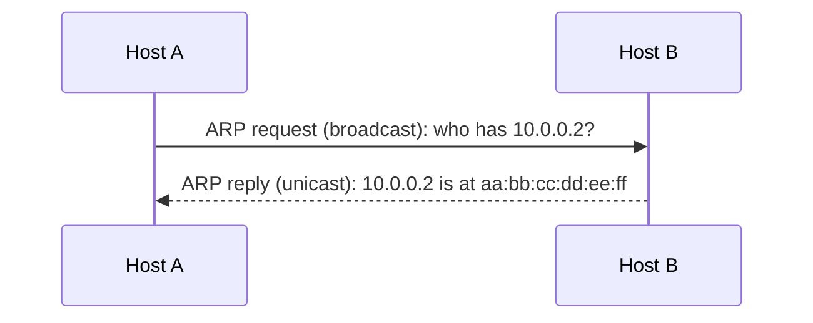

This note stays a draft. Open it with `hugo server -D` and keep the source side by side
with the preview. Snippet prefixes (type, then Tab) are in brackets.

## Callouts

> [!NOTE]
> Default callout. [`note`]

> [!TIP]
> Something useful. [`tip`]

> [!IMPORTANT]
> Don't skip this. [`important`]

> [!WARNING]
> This bites people. [`warning`]

> [!CAUTION]
> This breaks things. [`caution`]

> [!TIP] A custom title
> Text after `[!TIP]` on the first line replaces the label.

> [!NOTE]- Question: what does ARP map?
> IPv4 addresses to MAC addresses, within one broadcast domain.
> A trailing `-` makes the callout collapsed until clicked. [`fold`]

## Math

Inline: the hosts in a /24 are $2^{8} - 2 = 254$. A dollar sign in prose needs
a backslash: \$5.

Block: [`math`]

$$
\text{Throughput}_{\text{ALOHA}} = G \, e^{-2G}, \qquad
\max = \frac{1}{2e} \approx 0.184
$$

## Diagrams

[`mermaid`]



## Images

Paste a screenshot straight into the editor. VS Code saves it next to `index.md`
and writes the link. [`img`]


## Code

[`code`]

```console
$ ip neigh show
10.0.0.1 dev eth0 lladdr aa:bb:cc:dd:ee:01 REACHABLE
```

## Tables

[`table`]

| Prefix | Hosts |
|---|---|
| /24 | 254 |
| /30 | 2 |
